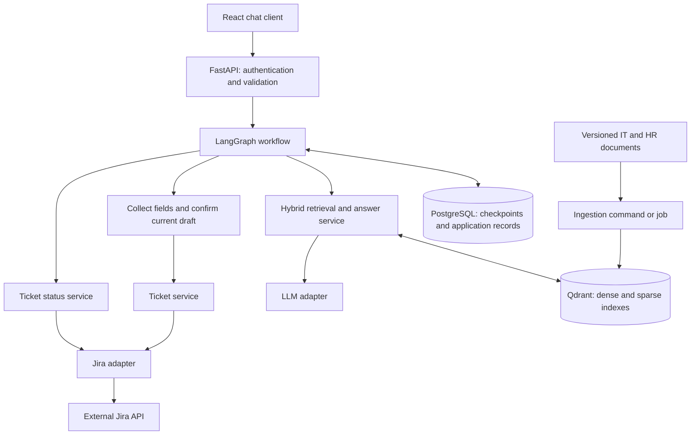

# SmartDesk AI — Implementation Plan

Status: Draft for review. Implementation has not started. Jira, a small paid API budget, later AWS hosting, and independently deployable frontend/backend images are confirmed requirements.

This plan follows PROJECT.md and the supplied marking rubric. Hybrid retrieval, source citations, reliable escalation, explicit ticket confirmation, persistent conversation context, and maintainable architecture are required deliverables.

## 1. Recommended stack and scope

Build a modular monolith: one Python backend with explicit module boundaries, a separate web client, and persistent infrastructure. This keeps the project understandable while allowing API replicas and independent ingestion jobs later.

| Area | Recommendation | Reason |
| --- | --- | --- |
| Backend | Python, FastAPI, Pydantic | Typed requests and responses, validation, dependency injection, and a documented HTTP API. |
| Orchestration | LangGraph with a PostgreSQL checkpointer | Explicit workflow transitions, persisted conversation state, and approval pauses that survive restarts. |
| Retrieval | Qdrant with dense vectors and BM25 sparse retrieval | Both semantic matches and exact terms can contribute to the same search pipeline. |
| Fusion and reranking | Reciprocal Rank Fusion (RRF), followed by a cross-encoder | Merge the two ranked lists, then evaluate query-passage relevance before answering. |
| Local inference | FastEmbed for an English embedding baseline and a CPU-capable reranker | Start with reproducible local retrieval models; benchmark on the available machine before fixing model IDs. |
| Answer generation | OpenAI GPT-6 Luna through a provider adapter, proposed baseline | Budget-oriented starting point; validate structured output and grounding on our evaluation set before fixing the model configuration. |
| Application storage | PostgreSQL, SQLAlchemy, Alembic | Persist users, ticket mappings, approval records, and creation attempts with migrations. |
| Ticket system | Jira Cloud, confirmed | Implement one real external integration behind a small provider interface. |
| Frontend | React, TypeScript, Vite | Chat, expandable citations, editable ticket previews, confirmation controls, and ticket selection. |
| Packaging | Independent backend and frontend packages and Dockerfiles; Docker Compose | Separately buildable and deployable images, with a reproducible local environment containing the API, UI, PostgreSQL, and Qdrant. |
| Quality | pytest, Ruff, mypy, frontend checks, Playwright, CI | Test business behavior and the complete user flows. |
| Evaluation | LangSmith experiments with versioned retrieval metrics and custom answer evaluators | Compare retrieval approaches, inspect unsupported claims, and publish an evidence-based report. |
| Observability | Structured logs and OpenTelemetry instrumentation | Track request latency, retrieval outcomes, failures, and external API calls with redacted identifiers. |

FastAPI supports modular routers and dependency injection. LangGraph documents persistent checkpoints and interrupt/resume behavior, which match the confirmation workflow. [FastAPI documentation](https://fastapi.tiangolo.com/tutorial/bigger-applications/), [LangGraph persistence](https://docs.langchain.com/oss/python/langgraph/persistence), [LangGraph interrupts](https://docs.langchain.com/oss/python/langgraph/interrupts).

Start with a single orchestrated workflow. Separate autonomous IT and HR agents, Kubernetes, cross-session personal memory, and semantic answer caching are deferred until the required flows are complete and there is evidence that the added complexity helps.

GPT-6 Luna is a proposed low-cost baseline, not a guarantee that it meets our grounding targets. Its documented structured-output and function-calling support fit the workflow. Use the Responses API through the backend adapter and retain model configuration outside business logic. Confirm API account access during setup; promote to a stronger model only if measured failures justify the added cost. Track cumulative usage and cap evaluation runs. [Official OpenAI model documentation](https://developers.openai.com/api/docs/models/gpt-6-luna), [OpenAI pricing](https://developers.openai.com/api/docs/pricing).

## 2. Architecture and ownership



The API handles transport and authorization. Application services enforce business rules. LangGraph coordinates those services. Domain objects do not depend on FastAPI, LangGraph, Qdrant, or Jira. Infrastructure adapters implement narrow interfaces for retrieval, LLM access, identity, and ticket operations.

Keep LangGraph checkpoints separate from application tables, even when they share one PostgreSQL instance. The external platform is the source of truth for ticket status; local ticket records associate employees with external ticket IDs and track creation attempts.

Proposed repository layout, to be created incrementally:

```text
agentic-IT-support-desk/
├── PROJECT.md
├── IMPLEMENTATION_PLAN.md
├── README.md
├── .env.example
├── compose.yaml
├── backend/
│   ├── pyproject.toml
│   ├── uv.lock
│   ├── Dockerfile
│   ├── .dockerignore
│   ├── src/smartdesk/
│   │   ├── main.py
│   │   ├── bootstrap.py          # Dependency wiring
│   │   ├── config.py
│   │   ├── api/                  # Routers, schemas, auth dependencies
│   │   ├── domain/               # Ticket, citation, identity, and error types
│   │   ├── application/
│   │   │   ├── ports.py          # Provider interfaces
│   │   │   ├── chat_service.py
│   │   │   ├── answer_service.py
│   │   │   └── ticket_service.py
│   │   ├── workflows/            # Graph, typed state, nodes, routing
│   │   ├── retrieval/            # Hybrid search, reranking, evidence checks
│   │   ├── ingestion/            # Load, validate, chunk, deduplicate, index
│   │   ├── infrastructure/
│   │   │   ├── llm/
│   │   │   ├── qdrant/
│   │   │   ├── jira/
│   │   │   ├── postgres/
│   │   │   └── identity/
│   │   ├── prompts/              # Versioned prompt templates
│   │   └── observability/
│   ├── migrations/
│   └── tests/
│       ├── unit/
│       └── integration/
├── frontend/
│   ├── package.json
│   ├── package-lock.json
│   ├── Dockerfile
│   ├── .dockerignore
│   ├── src/api/
│   ├── src/features/chat/
│   ├── src/features/tickets/
│   ├── src/components/
│   └── tests/
├── contracts/
│   └── openapi.json              # Exported API contract for client generation
├── knowledge_base/
│   ├── it/
│   ├── hr/
│   └── manifest.json
├── tests/
│   └── e2e/                     # Full-system browser journeys
├── evaluations/
│   ├── datasets/                 # Development and held-out cases
│   ├── runners/
│   └── reports/
├── docs/
│   ├── architecture.md
│   ├── decisions/
│   ├── operations.md
│   └── demo.md
├── deploy/
└── .github/workflows/
```

Dependencies point from transport and infrastructure toward application contracts and domain types. Avoid global clients, business rules in frontend components, and unrelated helpers collected in a generic utils module. Add abstractions for actual external boundaries rather than creating a class for every function.

Deployment boundaries:

- Build `smartdesk-backend` solely from `backend/` and `smartdesk-frontend` solely from `frontend/`. Both images have independent version tags and CI build jobs. Neither image needs the other source directory to build.
- Use a multi-stage frontend build and serve compiled static assets through a production HTTP server. Configure the API endpoint at container startup or through a same-origin reverse proxy so the frontend image can be promoted between environments without embedding secrets.
- Expose a versioned `/api/v1` HTTP contract. Generate frontend API types from the exported OpenAPI schema and check contract drift in CI. Stream progress events if useful; release answer content only after its evidence checks complete.
- Test backward-compatible API changes so frontend and backend releases do not require simultaneous deployment.
- PostgreSQL and Qdrant remain external to both application images. Ingestion uses the backend image as a separate command/job with the knowledge base mounted or supplied separately.
- Use Compose locally. Prepare the image and configuration boundaries for AWS, then choose and cost the hosting services in a later deployment phase. AWS deployment is deferred as requested.

## 3. Hybrid RAG and knowledge base

Prepare approximately 60–80 meaningful entries for one fictional company, spanning IT support, HR policies, onboarding, and payroll. Use consistent policy names and rules, with deliberate omissions such as monitor flickering and parking. Review any external dataset's license and content before reuse. Keep evaluation questions outside the indexed knowledge base.

Knowledge-base approach confirmed on November 7, 2026: follow PROJECT.md Option C, combining the HR dataset with LLM-generated IT support guides and troubleshooting documents.

| Source | Verified public metadata and preview | Planned use |
| --- | --- | --- |
| [strova-ai/hr-policies-qa-dataset](https://huggingface.co/datasets/strova-ai/hr-policies-qa-dataset) | Viewer reports 644 training rows; repository contains dataset.jsonl; messages contain system, user, and assistant roles. Dataset card declares MIT. | Extract user questions and assistant answers as candidate HR entries. Exclude embedded system instructions, deduplicate, and review policy consistency and topic coverage before indexing. |
| LLM-generated IT support guides and troubleshooting documents | Planned synthetic content for the same fictional company; documents have not yet been generated. | Cover password resets, VPN setup, MFA, software installation, Wi-Fi, email, and onboarding. Review technical procedures and policy consistency before indexing. |

The HR dataset's public page, file listing, and sample preview were accessible without authentication. The full file has not yet been downloaded or audited. Preserve its source revision, original row identifiers, and declared license information during ingestion. The Console-AI ticket dataset is excluded from the selected approach.

Label generated IT documents as synthetic and record the generation model, prompt version, and review status. Define fictional company settings explicitly; verify product-specific technical instructions against official documentation rather than treating LLM output as verified. Keep unsupported topics out so escalation remains testable. Create independent evaluation questions, group near-duplicates across evaluation splits, and recheck deliberate knowledge gaps against the final indexed corpus.

Each document records a stable ID, title, domain, source, version, effective date, and access scope. Prefer Markdown with structured metadata. Split by policy sections, starting around 300–500 tokens with limited overlap, bounded by the selected embedding model's input limit. Preserve short Q&A entries intact where appropriate. Chunk sizes are starting parameters, subject to evaluation.

The ingestion pipeline validates metadata, detects duplicates, creates stable chunk IDs, and computes a content hash. Unchanged content is skipped. Changed or deleted documents replace or remove stale chunks. Track the embedding model, chunker version, and corpus version; rebuild into a new collection when an incompatible index change is needed.

Query pipeline:

1. Resolve relevant conversational references, such as “that policy,” into a standalone question while retaining the original query.
2. Apply authorization and active-document filters consistently to both retrieval branches.
3. Retrieve an initial top 20 dense results and top 20 BM25 results. Preserve exact product names and error codes in the lexical query.
4. Fuse results with RRF and deduplicate by chunk ID. Do not add raw BM25 and cosine scores together.
5. Rerank approximately the top 20 fused candidates using a cross-encoder; send the best 4–6 passages to the answer stage within a token budget.
6. Assess whether the passages actually answer the question, including applicable policy conditions. Calibrate relevance thresholds on development cases; fused scores are ranking signals, not probabilities of correctness.
7. Generate an answer with supporting chunk IDs. Render citations from trusted document metadata, and validate that cited IDs belong to the retrieved evidence. Check material claims against the cited passages.
8. If evidence is insufficient, abstain and offer ticket creation. If the request is ambiguous, clarify first. If retrieval infrastructure fails, identify the service failure accurately and offer an appropriate next step.

RRF and dense/sparse combinations are supported by Qdrant; FastEmbed also provides cross-encoder reranking. [Qdrant hybrid queries](https://qdrant.tech/documentation/search/hybrid-queries/), [Qdrant hybrid text search](https://qdrant.tech/documentation/search/text-search/hybrid-search/), [FastEmbed reranking](https://qdrant.tech/documentation/fastembed/fastembed-rerankers/).

Measure dense-only, BM25-only, hybrid, and hybrid-plus-reranking using the same corpus and held-out questions. Report Recall@5, MRR, citation support, abstention quality, latency, and inference usage. Demonstrate gains on exact-term and paraphrase subsets; investigate regressions instead of assuming hybrid retrieval always wins.

## 4. Conversation and ticket workflows

Persist typed state containing conversation ID, authenticated user ID, employee email, active intent, current draft, draft version, pending confirmation, selected ticket, and relevant conversation history. Use bounded history plus a summary, while keeping critical ticket fields in structured state. Serialize updates to a conversation and reject stale revisions so concurrent messages cannot overwrite an approval.

Routing recognizes KB questions, explicit ticket requests, ticket status requests, greetings, ambiguous requests, and unsupported requests. Use structured model output and validate it before selecting an allowed transition. All branches have bounded retries and a clear terminal response.

Ticket creation:

1. Offer escalation when the KB cannot resolve the issue, or honor an explicit request to create a ticket.
2. Collect employee email, summary, and description; infer category and propose priority. Let the employee correct every field.
3. Persist and show the exact draft with Confirm, Edit, and Cancel actions. A clear conversational confirmation can also resume the pending approval.
4. Bind approval to the draft version and user. Editing the draft invalidates its approval. Enforce the approval check inside the ticket service, not only in a prompt.
5. Record a durable creation attempt before calling Jira. Include a unique correlation identifier in a configured searchable field or label, and save the returned external ID and link.
6. Repeated confirmation reuses the existing attempt. If a create request times out with an unknown outcome, reconcile against the external correlation identifier before any new create attempt; do not blindly retry the write.
7. Return the ticket ID and link only after confirmed creation. Preserve the draft and clearly report recoverable failures.

LangGraph interrupt nodes may execute again when resumed, so keep ticket side effects after approval and make the application service safe against replay. [LangGraph interrupt behavior](https://docs.langchain.com/oss/python/langgraph/interrupts).

Ticket status:

- Resolve the employee through the authenticated identity and a verified email-to-account mapping. For a restricted local demo, explicitly configured fictional identities are acceptable.
- Configure a dedicated employee identifier on external tickets, plus a local employee-to-ticket mapping. Do not assume Jira's reporter email search is available or that arbitrary email addresses identify accessible accounts.
- Fetch current status and permitted comments from the external API, including pagination and resolved tickets when relevant. Support zero, one, and multiple matches, and ownership checks for directly supplied ticket IDs.
- Do not turn a timeout or permission error into “no tickets found.” Show the appropriate failure and allow retry.

Validate required issue fields, project permissions, comment visibility, and the identity lookup strategy in an early Jira integration spike. Jira's API supports issue creation and retrieval, with project-specific fields and permissions that must be configured. [Jira Cloud issues API](https://developer.atlassian.com/cloud/jira/platform/rest/v3/api-group-issues/).

## 5. Production readiness and operation

Production readiness is an acceptance gate to verify, rather than a property guaranteed by a folder structure.

- Validate all configuration at startup. Keep credentials in environment variables locally and a deployment secret store when hosted. Commit only placeholder configuration.
- Require real authentication for a shared deployment, with conversation ownership and ticket authorization enforced server-side. A typed email address alone does not authorize access to tickets.
- Treat retrieved text as untrusted content. It cannot override workflow rules, approve a ticket, or invoke tools. Restrict external API operations to configured projects and approved operations.
- Set connection and request timeouts, bounded retries with backoff for transient safe operations, rate limits, and model token limits. Record request IDs and provider errors while redacting credentials and unnecessary personal data.
- Keep durable state outside API processes. Run CPU-heavy embedding and reranking work with bounded concurrency; move these behind an independent worker/service if measurements require it.
- Provide health and readiness endpoints, migrations, persistent volumes, backup/restore instructions, index rebuild instructions, and a deployment rollback procedure.
- CI checks formatting, types, unit/integration tests, frontend builds, and secret/dependency scanning. Run paid/live evaluations explicitly with a budget, and use a dedicated test project for ticket smoke tests.
- Before public deployment, verify authentication, TLS, origin restrictions, request limits, recovery behavior, and a documented load profile. AWS service selection and deployment costs will be reviewed in the later hosting phase.

## 6. Delivery milestones and acceptance evidence

| Milestone | Work | Completion evidence |
| --- | --- | --- |
| 1. Foundation and integration spike | Establish backend/frontend packages and separate image builds; scaffold API/configuration, Compose, migrations and CI; verify real ticket API access and employee lookup. | Each image builds independently; clean startup, working health checks, passing initial checks, and a successful create/read demonstration in a test project. |
| 2. Knowledge base and retrieval | Prepare consistent IT/HR content; build repeatable ingestion; implement dense, BM25, fusion, and reranking. | At least 60 meaningful entries; corpus metadata; retrieval comparison with relevant document labels. |
| 3. Grounded answers and escalation | Implement evidence checks, citations, routing, clarification, and abstention. | Reviewed answers with supported citations; deliberately missing topics produce escalation offers. |
| 4. Persistent ticket workflows | Implement field collection, draft editing, approval, durable creation attempts, status lookup, and checkpoint recovery. | End-to-end tests for confirmation, cancellation, duplicate requests, lost responses, restart/resume, and zero/one/many tickets. |
| 5. Frontend and complete journeys | Implement chat, source display, ticket preview and confirmation, ticket list, and visible loading/error states. | Browser tests covering all three required flows and multi-turn interruptions. |
| 6. Hardening and submission | Complete observability, authorization, failure tests, evaluation report, architecture diagram, README, and demo evidence. | Reproducible clean setup, CI success, documented limitations, and a rubric-to-evidence checklist. |

Build evaluation cases as each milestone is implemented. Use development cases for tuning and a held-out set for the final report. Aim for roughly 80 labeled retrieval/answer cases, split into 40 development and 40 held-out cases, plus at least 15 scripted conversation scenarios covering ticket and failure behavior. Label expected sources, expected answerability, and expected workflow outcomes.

| Rubric criterion | Planned evidence for an excellent submission |
| --- | --- |
| RAG grounding | Each substantive KB answer cites real supporting passages; final reviewed cases contain no unsupported material claims. Invalid citations and injected instructions are tested. |
| Escalation logic | Unanswerable and ambiguous cases are labeled separately; report both correct escalation and unnecessary escalation on answerable questions. |
| Ticket creation | Required fields are validated; edits require renewed confirmation; the real platform returns an ID; retry and replay tests show duplicate protection. |
| Ticket status | Live API fetch; multiple-ticket selection; zero-ticket behavior; stale/missing/unauthorized IDs and API failures tested. |
| Multi-turn context | Email remembered; contextual follow-ups resolved; draft and selection survive restart; users' conversations remain isolated. |
| Knowledge base | 60–80 useful entries spanning both domains, clear metadata, consistent policies, and documented gaps. |
| Code and documentation | Defined module boundaries, type checks, meaningful tests, clean-clone instructions, architecture diagram, configuration guide, and demo walkthrough. |
| Hybrid-search bonus | Reproducible comparison with dense-only and sparse-only baselines, including quality and latency tradeoffs. |

Initial quality targets are Recall@5 of at least 90% on held-out answerable cases and at least 90% correct abstention on held-out unknown cases, while also reporting false escalations. These are targets, not measured results. All deterministic approval, ownership, and required-field cases must pass. Any unsupported material claim in the final reviewed sample requires investigation and correction; evaluation cannot prove the model will never hallucinate on unseen inputs.

Use a custom LangSmith faithfulness evaluator as an additional signal, alongside source labels and human review; an LLM judge is not the sole acceptance check. [LangSmith SDK](https://reference.langchain.com/python/langsmith).

## 7. Confirmed decisions and remaining inputs

Confirmed by the user: Jira; a small paid LLM/API budget; a monorepo with independently deployable frontend and backend container images; AWS available, with hosting deferred until later; Option C for the knowledge base, using strova-ai/hr-policies-qa-dataset plus LLM-generated IT guides and troubleshooting documents.

Remaining scheduling input: submission deadline. During implementation setup, verify Jira project permissions and API credentials, model account access, and available RAM for local retrieval models. Store credentials locally through configuration; do not place them in the plan or source files.

Planning assumptions pending review: English-language content, one fictional company, one ticket provider, React/TypeScript for the frontend, and a Docker-capable development machine. Keep real employee data out of the demo corpus. Implementation begins after the user reviews and approves this plan.


## Implementation status: 2026-11-08

Implementation was authorized. The monorepo, separate images, persistent workflows, hybrid retrieval, 64-document corpus, UI, and local verification are in place. See [README](README.md) and [verification evidence](docs/verification.md). Backend tests: 25 passed. Browser tests: 4 passed. Type, lint, formatting, frontend build, migrations, and container startup checks passed. Held-out hybrid/reranked Recall@5: 100% across 32 answerable cases. Live model evaluation remains pending OPENAI_API_KEY. AWS hosting and hosted CI have not been executed; production acceptance gates remain open.

The authorized live Jira smoke test subsequently passed: SCRUM-5 was created and its status fetched. OpenAI answer-quality verification still requires a locally configured API key.


Update 2026-11-14: OpenAI access is verified with gpt-4o-mini (the configured key rejects gpt-5-mini). Final live smoke checks passed 4/6; false escalation on an answerable HR question and follow-up remains unresolved. See docs/verification.md. Credentials are no longer the blocker; model/prompt reliability and full held-out answer evaluation remain acceptance work.
