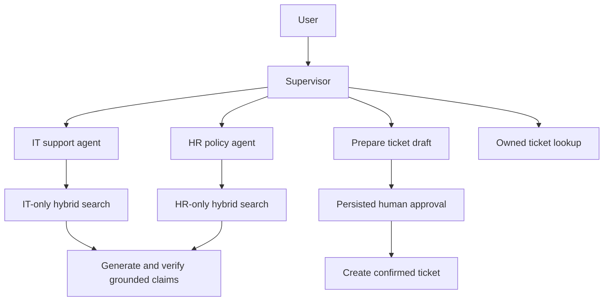

# Agents and evaluation

SmartDesk uses a bounded supervisor/specialist architecture built with LangGraph. The supervisor resolves conversation references and selects IT or HR. Each specialist has its own prompt and domain-scoped retrieval capability, generates claims from evidence, and verifies them before returning an answer. These are specialised model-backed subgraphs, not autonomous agents allowed to execute arbitrary tools.



## Code boundaries

```text
backend/src/smartdesk/
  agents/
    supervisor_agent.py       # History-aware classification and handoff
    it_support_agent.py       # IT specialist composition
    hr_policy_agent.py        # HR specialist composition
    specialist_graph.py      # Shared search/generate/verify execution
    prompts/
      it_support.txt
      hr_policy.txt
  tools/
    knowledge_search.py      # Domain fixed at construction, traced capability
    ticket_tools.py          # Draft, confirmed creation, owned status lookup
  workflows/
    conversation_state.py    # Durable shared state contract
    conversation_workflow.py # Graph composition and transitions only
    ticket_approval.py       # Interrupt/resume, preview versions, cancellation
  rag/                       # Shared ingestion, retrieval, generation, verification
  observability/
    langsmith_tracing.py     # Explicit opt-in tracing configuration
```

Specialists cannot call Jira. Ticket operations still enforce identity, ownership, explicit confirmation, and duplicate prevention in `TicketService`. The workflow preserves pending drafts across specialist questions. Mixed IT/HR requests ask which part to address first; this implementation does not fan out to multiple specialists for one question.

Domain filtering occurs inside both Qdrant search branches before candidate selection, together with access-scope filtering. It is not filtering only the final top five results. Shared RAG algorithms are implemented once.

## LangSmith

Set these locally in `.env` (never commit the key):

```dotenv
LANGSMITH_TRACING=true
LANGSMITH_API_KEY=your-local-key
LANGSMITH_PROJECT=smartdesk-development
LANGSMITH_ENDPOINT=https://api.smith.langchain.com
LANGSMITH_HIDE_INPUTS=true
LANGSMITH_HIDE_OUTPUTS=true
```

Use `https://eu.api.smith.langchain.com` for an EU workspace. Restart the backend after configuration. LangGraph emits nested workflow and specialist traces; the OpenAI wrapper traces model calls and the knowledge search capability emits tool spans. Payload hiding is enabled by default because application traces include employee conversations. To inspect synthetic evaluation inputs/outputs, explicitly disable hiding for that evaluation environment only.

Open the configured project under LangSmith Tracing to inspect execution. Hosted verification requires a configured key. No hosted run or dashboard link is claimed until publishing succeeds.

## Reproducible evaluation commands

Run from `backend/`:

```powershell
uv sync --group dev
uv run python ../evaluations/runners/evaluate.py --local --split held_out --output ../evaluations/reports/current.json
uv run python ../evaluations/runners/langsmith_experiment.py ../evaluations/reports/current.json --dataset-name smartdesk-held-out-v1
```

The second runner creates a new, versioned dataset and four scored LangSmith experiments from recorded retrieval results. It deliberately fails if the dataset name already exists. Run with a fresh name for a new benchmark version. Experiment metadata says `recorded-replay`: LangSmith's execution latency is replay overhead; actual search latency is `recorded_latency_ms` in each output. No model calls are made by this publisher.

Paid answer generation exercises the supervisor and specialist handoff, without granting Jira write capabilities:

```powershell
uv run python ../evaluations/runners/evaluate.py --local --split held_out --with-answers --limit 40 --output ../evaluations/reports/answers.json
uv run python ../evaluations/runners/langsmith_answer_experiment.py ../evaluations/reports/answers.json --dataset-name smartdesk-answers-v1 --limit 5 --with-judge
```

LangSmith is the only evaluation framework. `answer_evaluators.py` contains custom citation-coverage and LLM-judge evaluators. The judge uses `gpt-4o-mini` with bounded output, no automatic retries, and one call per cited answer. It uses full retrieved contexts in new reports, falling back to cited excerpts for legacy reports. Scores are published directly to LangSmith. The new evaluator has local contract tests; hosted evaluation remains unverified until a configured run succeeds.

To publish answers and citation coverage without paid judge calls:

```powershell
uv run python ../evaluations/runners/langsmith_answer_experiment.py ../evaluations/reports/answers.json --dataset-name smartdesk-answer-coverage-v1 --limit 40
```

Experiments replay recorded answers and include original total-answer and selected counts in metadata. All selected answers receive citation-coverage feedback. Uncited answers do not receive fabricated faithfulness or relevance scores. Coverage is not correctness; inspect false abstentions alongside the judged subset. Failed judge calls are evaluation errors, not zero scores. These scores are not directly comparable to scores from retired evaluator implementations.

## Evidence and limits

The fresh 32-answerable-case held-out retrieval comparison reproduced dense Recall@5 0.96875 / MRR 0.86458 and hybrid+reranked Recall@5 1.0 / MRR 0.89010. That is +3.125 percentage points recall and +0.02552 MRR, with additional reranking latency. Hybrid without reranking has MRR 0.86198, slightly below dense: improvement is not universal. The development split previously favored dense retrieval.

These cases are assistant-authored, not an independent human-labeled benchmark. The retrieval experiment searches both domains to isolate retrieval-method differences; agent evaluation additionally exercises domain selection. Unknown cases are excluded from retrieval metrics. The old 4/6 live smoke result predates this architecture and must not be presented as a new result.

Only completed evaluations produce evidence. Backend tests use provider doubles; they verify boundaries and workflows rather than live answer accuracy.

On 2026-11-16, a two-question live HR smoke run produced one cited answer and one false abstention. This remains recorded in `evaluations/reports/status.json`. Earlier judge reports are historical artifacts from retired integrations, not LangSmith evaluation results. LangSmith hosted publishing remains pending workspace credentials.

Framework reference: [LangSmith SDK](https://reference.langchain.com/python/langsmith).
