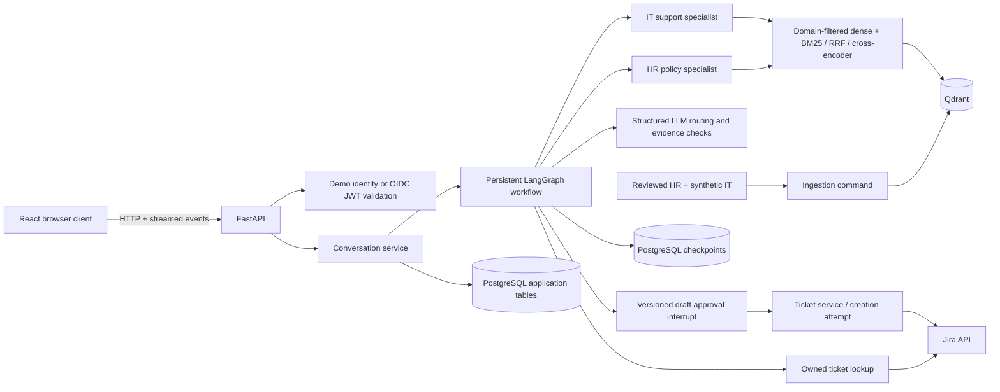

# SmartDesk architecture

The repository contains two independently buildable applications. The backend is a modular monolith with FastAPI transport, LangGraph orchestration, chat/ticket application services, and a self-contained `smartdesk.rag` feature. Shared adapters handle OpenAI, Jira, identity, and PostgreSQL; the Qdrant adapter belongs to RAG. The React frontend uses the versioned API; it does not access provider credentials or databases.

## RAG module boundaries

`rag/ingestion.py` owns indexing: `document_loader.py` reads reviewed Markdown, `chunking.py` produces passages, `embedding.py` creates dense/sparse vectors, and `qdrant_store.py` persists them. There is one ingestion implementation. It compares hashes, rejects incompatible index signatures, updates changed chunks, and removes stale chunks only after successful upserts. Ingestion does not load the reranker.

`rag/retrieval.py` owns query embedding, candidate search, optional reranking, score filtering, and final context selection. Qdrant-specific requests and native RRF fusion stay in `qdrant_store.py`. Cross-encoder model loading and ranking stay in `reranking.py`. Both embedding and reranking adapters load lazily. Retrieval concurrency remains bounded to two calls per pipeline instance.

`rag/query_pipeline.py` remains the standalone grounded-answer entry point and component bundle. The conversation graph delegates to specialised IT and HR agents, which use its retrieval, generation, and verification components as separate graph steps. RAG returns `AnswerResult` from `rag/rag_models.py` and does not import FastAPI schemas, Jira services, or conversation storage. `rag/rag_interfaces.py` declares component contracts so pipelines can run with alternative implementations or controlled test doubles. See [agents and evaluation](agents_and_evaluation.md) for agent/tool boundaries and LangSmith setup.

`rag/rag_factory.py` constructs concrete embedding, store, and reranking components for application startup, the CLI, and evaluation. Its returned component bundle owns the Qdrant client and must be closed by the caller. The shared OpenAI client remains in `infrastructure/llm/` because routing and conversation summarization also use it; answer and verifier prompts belong to `rag/answer_prompts/`.

This refactor preserves the `paragraph-v1` chunker, content hashes, UUID-based point IDs, named vectors, collection name, and index signature format. Existing collections can be reused. It does not change retrieval thresholds or resolve the documented model false-escalation issues.

## Conversations

A conversation has an owner and UUID. Its UUID is also the LangGraph thread ID. The frontend sends that ID on every turn and reloads the transcript after reconnecting. The server checks ownership on every read and write. The browser's local storage contains only the conversation ID; it does not authorize access.

PostgreSQL stores conversation metadata, ordered messages, request deduplication records, and ticket attempts. LangGraph stores graph checkpoints separately. Recent messages are passed to the router; older messages are summarized when the recent window is exceeded. Verified email, draft contents/version, and approval remain structured fields. Full transcripts remain stored even when the prompt history is compacted.

The router resolves conversational references into standalone retrieval queries. Retrieval runs again for follow-ups. Previous assistant messages help identify the topic, but source passages must support the answer. Ambiguous references should produce a clarifying question.

## Grounding

Documents have stable IDs, provenance, versions, and access scope. Both retrieval branches apply the employee-scope filter. Dense and BM25 rankings are merged with RRF. A cross-encoder reranks candidates. Numeric score rejection is optional and disabled by default following development-set evidence that a zero cutoff rejected useful passages.

The answer model emits claims and supporting chunk IDs. The service rejects nonexistent IDs and sends the claims to a second evidence check. Citations are rendered from retrieved metadata. Unsupported answers become escalation offers. These checks reduce unsupported output but still require live evaluation and review; they do not prove zero hallucinations.

## Approval and external writes

Drafts are displayed with employee email, summary, description, category, and requested priority. Editing increments the draft version. Confirmation must match the pending version. A persisted interrupt supports page refresh and server restart. Asking a side question preserves the draft and returns to its approval pause.

A unique creation-attempt record is committed before contacting Jira. The correlation label is attached to the issue in the same create request. Explicit provider rejections can be retried; uncertain outcomes are reconciled by searching the label. If reconciliation finds no unique ticket, the service reports uncertainty and does not issue another create request. Jira status is always fetched live.

An email-derived employee label enables lookup of tickets created or deliberately tagged for this application. It does not import all existing Jira tickets. Only a verified identity's label is used, and direct ticket IDs must pass ownership checks. Restricted Jira comments are excluded from the response.

## Transport and concurrency

The chat endpoint streams progress/heartbeat events over HTTP and releases the verified answer as a final event. It does not stream unverified tokens. Ticket approvals use a normal POST. Disconnecting a stream does not undo work already committed; reload the conversation before retrying.

PostgreSQL advisory locks serialize updates to the same conversation across backend replicas. SQLite and its checkpointer are used only for isolated tests. Unique request IDs prevent replay of completed operations. An interrupted request ID is rejected with a recovery message; the user can reload persisted state and reconcile the pending ticket. Full automated recovery of every crash point is a remaining operational hardening item.

## Deployment boundary

Each application has its own Dockerfile, dependencies, lockfile, tests, and image tag. Nginx serves the frontend and proxies `/api` to the configured backend. Runtime config contains public UI configuration only. PostgreSQL and Qdrant use persistent storage outside the application images. Compose binds the demo application to loopback. AWS hosting is deferred.
